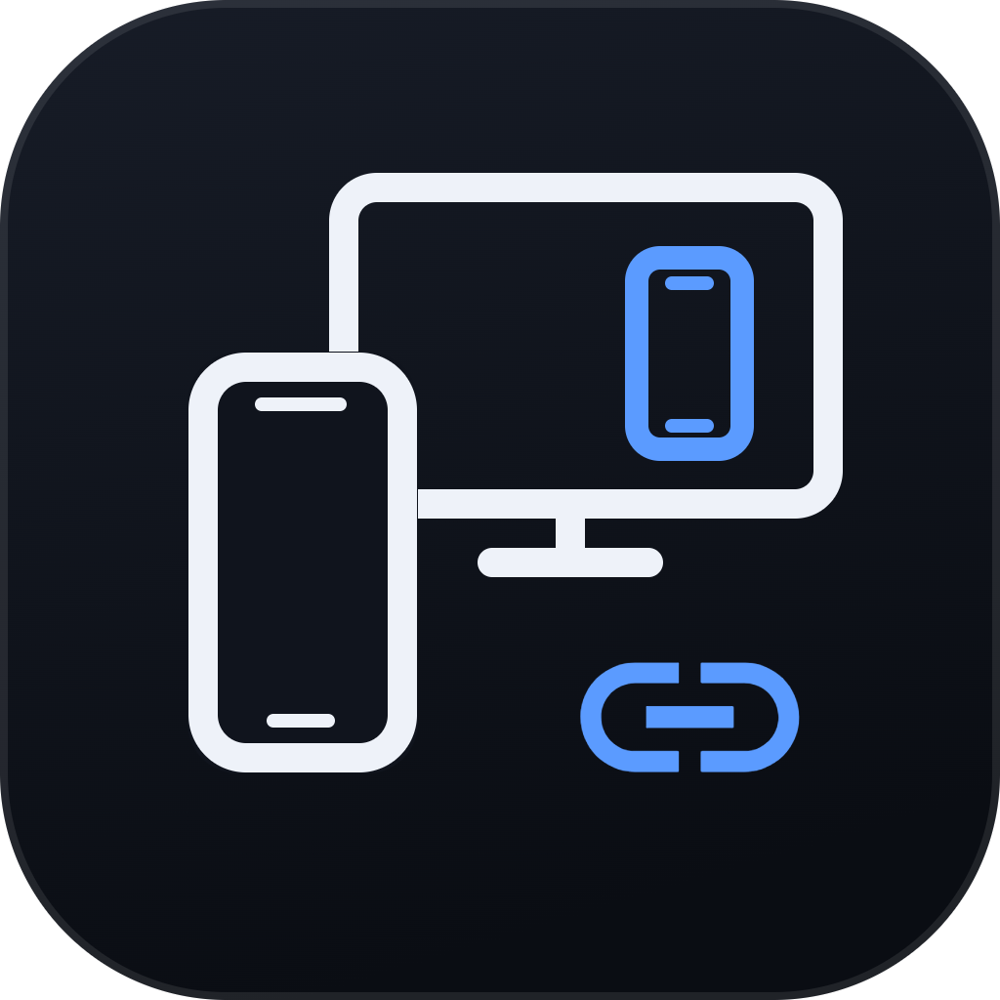

<div align="center">



# DuoLink

**Your Android phone and your PC, working as one.**

Messages, calls, notifications, clipboard, files, gallery, screen mirroring, a
phone webcam, and phone apps in windows of their own — over your own Wi-Fi.
No account, no cloud, nothing leaves the network.

[](#desktop)
[](#android)
[](https://github.com/aliiraza3321/DuoLink/actions/workflows/build-apk.yml)

</div>

---

## Download

The PC app and the phone app are released separately. Install the PC app first:
its last screen shows the QR for the phone app.

### <a id="desktop"></a>DuoLink for Windows

| | Version | Size | Requirements |
|---|---|---|---|
| [**DuoLink Setup 1.1.0.exe**](https://github.com/aliiraza3321/DuoLink/releases/download/desktop-1.1.0-4/DuoLink-Setup-1.1.0.exe) | 1.1.0 | 82 MB | Windows 10 (2004+) or Windows 11, 64-bit |

Release notes and the checksum live on the
[Windows release page](https://github.com/aliiraza3321/DuoLink/releases/tag/desktop-1.1.0-4).

### <a id="android"></a>DuoLink for Android

| | Version | Size | Requirements |
|---|---|---|---|
| [**DuoLink.apk**](https://github.com/aliiraza3321/DuoLink/releases/latest/download/DuoLink.apk) | 1.1.0 | 43 MB | Android 8.0 or newer, same Wi-Fi as the PC |

`releases/latest/download/DuoLink.apk` always serves the newest build, so that
link is safe to bookmark or share. CI builds and publishes the APK on every
non-documentation push.

> [!NOTE]
> Neither file is code-signed yet. Windows SmartScreen may warn the first time —
> choose **More info → Run anyway**. On Android, allow installs from your browser
> when prompted.

---

## Install

1. **Windows** — run the installer, keep *Create a desktop shortcut* ticked if you
   want one, and press **Install**. Setup adds a Start Menu shortcut and a
   Windows Firewall rule for private networks only.
2. **Android** — scan the QR on the installer's last screen, or download the APK
   above, and allow the install.
3. **Pair** — open DuoLink on the PC, scan the QR with the phone, and confirm the
   six-digit code on both screens. The phone reconnects by itself from then on.
4. **App windows (optional, once)** — open **Apps → Advanced · Wireless
   debugging**, enable Wireless debugging in Developer options on the phone, and
   pair it. After that each app you open gets its own PC window.

The full walkthrough, including every permission, is in
[docs/guide/getting-started.md](docs/guide/getting-started.md).

---

## Features

| | | |
|---|---|---|
| **Pairing** | One QR scan, single-use token | Certificate fingerprint pinned |
| **Messages** | Read and reply to SMS threads | Delete, new conversation, call |
| **Calls** | Live call state, dialpad, call log | Answer, reject, end, call back |
| **Notifications** | Mirrored live with app icons | Inline reply, per-app mute, dismiss |
| **Clipboard** | Two-way, optional auto-sync | Copy here, paste there |
| **Files** | Send by picker or drag-and-drop | Browse the PC from the phone |
| **Gallery** | Albums, day-grouped grid | Open, download, share, delete |
| **Phone screen** | Its own resizable window | Input, record, screenshot, volume |
| **Webcam** | Phone camera in Zoom, Teams, OBS | Torch, lens switch, screenshot, record |
| **Apps** | Every app, real name and icon | One PC window per open app |

---

## How it works

```
┌───────────────────────────┐        TLS-pinned WSS         ┌──────────────────────────┐
│  DuoLink for Windows      │◄───── local network only ────►│  DuoLink for Android     │
│  Electron main process    │       port 3000, mDNS         │  Kotlin + Compose        │
│  • HTTPS/WSS server       │                               │  • Foreground service    │
│  • Pairing + sessions     │       JSON message types      │  • MediaProjection       │
│  • Files, clipboard, ADB  │       (SMS, CALLS, MEDIA…)    │  • Accessibility input   │
└───────────────────────────┘                               └──────────────────────────┘
```

- **Pairing** — the QR encodes host, port, a single-use token and the SHA-256
  fingerprint of the PC's self-signed certificate, so the phone pins the server
  and a look-alike on the LAN cannot intercept it.
- **Sessions** — a 256-bit secret is kept in Android's Keystore; reconnects use
  an HMAC-SHA256 challenge/response.
- **Transports** — one WebSocket per phone, with separate binary channels for
  media and screen frames so chat never stutters.
- **App windows** — each app is launched onto its own virtual display by a
  helper that runs through the phone's own wireless-debugging shell. No root, no
  second app on the phone.

---

## Build from source

Desktop (Electron):

```bash
cd desktop
npm install
npm run dist          # installer in desktop/dist
npm start             # run from source
```

Android (Gradle):

```bash
cd android
./gradlew assembleDebug        # APK in android/app/build/outputs/apk/debug
./gradlew assembleRelease      # needs android/keystore.properties
```

---

## Troubleshooting

| Symptom | Fix |
|---|---|
| Phone won't pair | Both devices must be on the same Wi-Fi. Turn off AP/client isolation on the router. |
| Windows Firewall prompt | Allow DuoLink on **private networks** only. |
| Messages or calls are empty | Grant SMS and Call-log permissions in Android settings. |
| Mirroring shows a black frame | Accept the screen-capture prompt on the phone. |
| App list is empty | Open **Apps → Refresh**; update the APK if it is older than the PC app. |
| App windows won't open | Re-pair under **Apps → Advanced · Wireless debugging**. |

---

## Privacy

No account, no telemetry, no cloud. Pairings and settings stay on your PC and in
the phone's Keystore; the only network request the desktop app makes is an update
check against GitHub Releases. Uninstalling removes the app, its settings and its
pairings — received files stay in `Downloads\DuoLink`.

## Contributing

Issues and pull requests are welcome. Please keep changes focused: one feature or
fix per pull request, and say what you tested on real hardware.

<div align="center">

**DuoLink** — two screens, one system.

</div>
